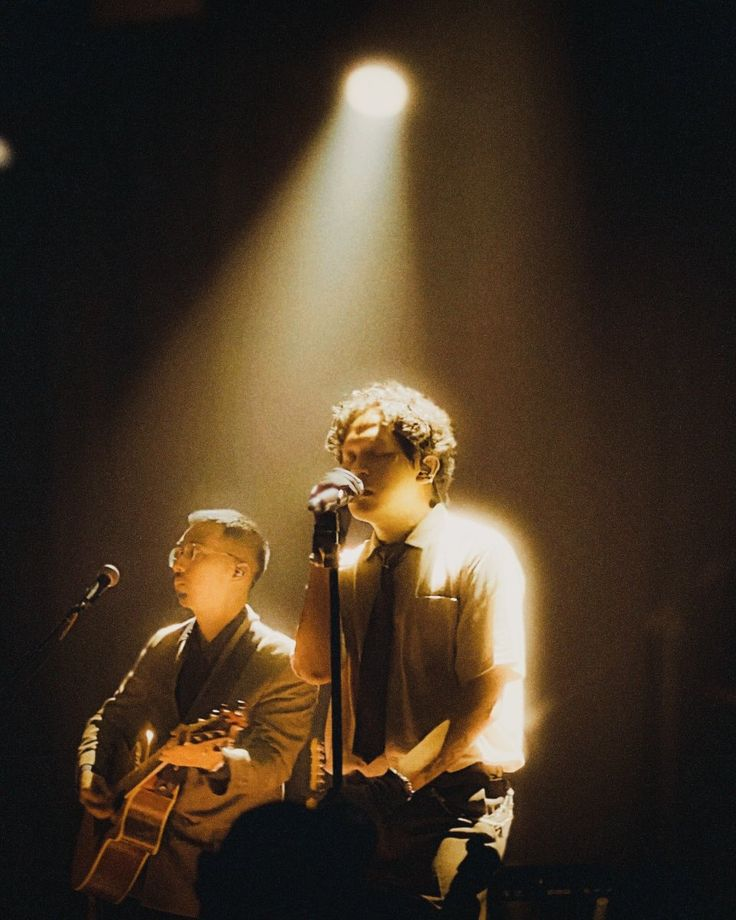

# PRD — Website Konser / Event Offline

## 1. Ringkasan Produk

**Nama proyek:** EventWave Offline  
**Jenis:** Website promosi dan informasi konser/event  
**Target platform:** Desktop dan mobile browser  
**Mode:** 100% offline setelah file proyek tersedia di perangkat

Website ini dirancang untuk menampilkan informasi konser/event secara modern, interaktif, dan responsif tanpa membutuhkan koneksi internet. Seluruh HTML, CSS, JavaScript, font, ikon, dan gambar harus disimpan secara lokal di dalam folder proyek.

## 2. Tujuan

- Menyediakan landing page konser/event yang menarik.
- Menampilkan informasi event secara lengkap dan mudah dipahami.
- Memberikan pengalaman interaktif melalui JavaScript tanpa backend.
- Memastikan website dapat dibuka melalui `index.html` tanpa koneksi internet.
- Tidak bergantung pada CDN, API eksternal, Google Fonts, library online, embed, atau resource remote.

## 3. Target Pengguna

- Pengunjung yang ingin mengetahui detail konser/event.
- Pengunjung yang ingin melihat lineup, jadwal, venue, harga tiket, dan FAQ.
- Admin/developer yang membutuhkan website event statis yang mudah dipindahkan dan dijalankan secara lokal.

## 4. Ruang Lingkup

### Halaman utama

Landing page harus memiliki:

1. **Navbar**
   - Logo/nama event.
   - Menu: Home, About, Lineup, Schedule, Tickets, Venue, FAQ.
   - Tombol CTA "Buy Ticket".
   - Mobile hamburger menu.

2. **Hero Section**
   - Nama event.
   - Tanggal dan lokasi.
   - Headline singkat.
   - CTA "Get Tickets".
   - CTA sekunder "View Lineup".
   - Background image lokal.
   - Overlay/gradient agar teks tetap terbaca.

3. **Countdown**
   - Countdown menuju tanggal/jam event.
   - Format hari, jam, menit, detik.
   - Berjalan menggunakan JavaScript.
   - Jika event sudah dimulai, tampilkan status yang sesuai.

4. **About Event**
   - Deskripsi event.
   - Highlight pengalaman/acara.
   - Informasi tanggal, lokasi, dan durasi.

5. **Lineup / Artists**
   - Grid kartu artis/pembicara.
   - Foto lokal.
   - Nama dan genre/kategori.
   - Efek hover.
   - Modal/detail sederhana ketika kartu diklik.

6. **Schedule**
   - Timeline atau tabel jadwal.
   - Filter berdasarkan hari/stage bila diperlukan.
   - Data disimpan dalam JavaScript lokal.

7. **Ticket Section**
   - Minimal 3 kategori tiket:
     - General Admission
     - VIP
     - Premium/VVIP
   - Harga.
   - Benefit.
   - Tombol pembelian.
   - Tombol dapat membuka modal form simulasi pembelian.
   - Tidak perlu payment gateway atau backend.

8. **Venue**
   - Nama venue.
   - Alamat.
   - Informasi akses/transportasi.
   - Gunakan ilustrasi atau gambar peta lokal jika diperlukan.
   - Jangan menggunakan Google Maps embed karena website harus offline.

9. **FAQ**
   - Accordion pertanyaan dan jawaban.
   - Dibuat menggunakan JavaScript.

10. **Gallery**
    - Grid foto event.
    - Lightbox ketika gambar diklik.
    - Semua gambar harus lokal.

11. **Footer**
    - Nama event.
    - Navigasi.
    - Kontak.
    - Social media sebagai informasi visual saja atau tautan eksternal opsional.
    - Copyright.

## 5. Fitur Interaktif

Semua fitur berikut harus berjalan tanpa internet:

- Mobile navigation.
- Smooth scrolling.
- Countdown timer.
- Modal detail artis.
- Modal simulasi pembelian tiket.
- Validasi form sederhana.
- FAQ accordion.
- Gallery lightbox.
- Filter lineup/jadwal.
- Active navigation state.
- Scroll reveal animation.
- Back-to-top button.
- Toast notification untuk aksi pengguna.
- Theme toggle opsional: dark/light.

## 6. Ketentuan Offline

Ini adalah requirement utama.

### Dilarang

- CDN.
- Google Fonts.
- Font Awesome CDN.
- Bootstrap CDN.
- Tailwind CDN.
- React/Vue/Angular dari CDN.
- API eksternal.
- Google Maps embed.
- YouTube embed.
- Spotify embed.
- Remote image URL.
- Remote JavaScript.
- Remote CSS.
- Tracking/analytics eksternal.

### Wajib

Semua dependency harus lokal.

Contoh:

```text
eventwave/
├── index.html
├── css/
│   └── style.css
├── js/
│   └── script.js
├── assets/
│   ├── images/
│   │   ├── hero.jpg
│   │   ├── artist-01.jpg
│   │   ├── artist-02.jpg
│   │   ├── artist-03.jpg
│   │   └── gallery/
│   ├── icons/
│   └── fonts/
└── README.md
```

Website harus dapat dibuka dengan cara:

```text
double-click index.html
```

dan fungsi utama tetap berjalan tanpa koneksi internet.

## 7. Teknologi

Gunakan hanya:

- HTML5
- CSS3
- Vanilla JavaScript
- Local image assets
- Local fonts jika diperlukan

Tidak wajib menggunakan framework.

## 8. Design Direction

### Visual

Tema utama: **modern concert / music festival**.

Karakter desain:

- Enerjik.
- Premium.
- Dramatis.
- Modern.
- Memiliki visual yang kuat.
- Cocok untuk konser musik atau festival.

### Warna

Gunakan palet gelap sebagai dasar, misalnya:

- Background: hitam/near-black.
- Surface: dark gray.
- Primary accent: warna neon atau vibrant.
- Text: putih.
- Secondary text: abu-abu terang.

Jangan terlalu banyak warna agar desain tetap premium.

### Typography

Gunakan font lokal atau system font stack, misalnya:

```css
font-family:
  Inter,
  Arial,
  Helvetica,
  sans-serif;
```

Jika menggunakan font eksternal, file font harus ditempatkan di:

```text
assets/fonts/
```

dan dipanggil menggunakan `@font-face`.

## 9. Responsive Design

Website wajib responsive pada:

- Mobile: 320px–767px
- Tablet: 768px–1023px
- Desktop: 1024px+

Prioritas:

- Tidak ada horizontal scrolling.
- Tombol mudah disentuh di mobile.
- Navbar berubah menjadi hamburger menu.
- Grid kartu berubah menjadi layout satu/dua kolom sesuai ukuran layar.
- Typography menggunakan ukuran responsif.
- Gambar tidak menyebabkan layout overflow.

## 10. Struktur HTML

Gunakan semantic HTML5:

```html
<header>
<nav>
<main>
<section>
<article>
<footer>
```

Setiap section harus memiliki heading yang jelas.

Gunakan:

- `alt` pada gambar.
- `label` untuk input.
- Button untuk aksi.
- Link untuk navigasi.

## 11. JavaScript Architecture

JavaScript harus vanilla dan terstruktur.

Contoh pembagian fungsi:

```javascript
initNavigation();
initCountdown();
initArtistModal();
initTicketModal();
initFaq();
initGallery();
initScheduleFilter();
initScrollReveal();
initBackToTop();
```

Hindari JavaScript inline jika memungkinkan.

Data event dapat disimpan sebagai object/array:

```javascript
const artists = [
  {
    name: "Artist Name",
    genre: "Electronic",
    image: "assets/images/artist-01.jpg",
    description: "Artist description"
  }
];
```

## 12. Ticket Modal

Ketika pengguna menekan "Buy Ticket":

1. Modal muncul.
2. Pengguna memilih tipe tiket.
3. Pengguna mengisi:
   - Nama
   - Email
   - Jumlah tiket
4. JavaScript melakukan validasi.
5. Setelah submit, tampilkan notifikasi bahwa ini adalah simulasi pemesanan.

**Catatan:** Tidak ada transaksi uang sungguhan dan tidak ada koneksi payment gateway.

## 13. Accessibility

Website harus memperhatikan:

- Kontras warna yang baik.
- Keyboard navigation.
- Focus state pada tombol/link.
- `aria-label` untuk tombol icon-only.
- Modal dapat ditutup dengan tombol close dan tombol Escape.
- Gambar memiliki alt text.
- Jangan menyampaikan informasi hanya melalui warna.

## 14. Performance

Target:

- Tidak memuat asset yang tidak digunakan.
- Kompres gambar.
- Gunakan format WebP/JPG/PNG sesuai kebutuhan.
- Gunakan lazy loading untuk gambar gallery.
- Minimalkan ukuran JavaScript dan CSS jika memungkinkan.
- Tidak ada network request eksternal.

## 15. Image Requirements

Semua gambar harus berada di folder lokal.

Contoh:

```text
assets/images/
├── hero.jpg
├── about.jpg
├── artist-01.jpg
├── artist-02.jpg
├── artist-03.jpg
├── venue.jpg
└── gallery/
    ├── gallery-01.jpg
    ├── gallery-02.jpg
    └── gallery-03.jpg
```

Gunakan gambar placeholder lokal jika gambar final belum tersedia.

Jangan menggunakan:

```html

```

Gunakan:

```html

```

## 16. Content Structure

Contoh konten:

**Event:** NIGHTWAVE FESTIVAL  
**Date:** 24 October 2026  
**Location:** Jakarta, Indonesia

### Hero

> Feel the night. Hear the wave.

### CTA

- Get Tickets
- Explore Lineup

### Lineup

Minimal 6 kartu artis untuk membuat halaman terasa lengkap.

### Ticket

| Tier | Harga | Benefit |
|---|---:|---|
| General Admission | Rp350.000 | Festival access |
| VIP | Rp750.000 | VIP area + perks |
| Premium | Rp1.250.000 | Premium access + exclusive perks |

Harga dan nama dapat diganti sesuai event.

## 17. User Flow

### Flow 1 — Melihat event

```text
Open index.html
↓
Hero
↓
Countdown
↓
About
↓
Lineup
↓
Schedule
↓
Tickets
↓
Venue
↓
FAQ
↓
Footer
```

### Flow 2 — Membeli tiket

```text
Klik Buy Ticket
↓
Ticket Modal
↓
Pilih Ticket Tier
↓
Isi Form
↓
Validasi
↓
Submit
↓
Success Toast
```

### Flow 3 — Melihat artis

```text
Lineup
↓
Klik Artist Card
↓
Artist Modal
↓
Baca Detail
↓
Close
```

## 18. Acceptance Criteria

Website dianggap selesai jika:

- [ ] `index.html` dapat dibuka langsung.
- [ ] Website tetap berfungsi ketika Wi-Fi/internet dimatikan.
- [ ] Tidak ada request ke CDN.
- [ ] Tidak ada remote image.
- [ ] CSS tersimpan lokal.
- [ ] JavaScript tersimpan lokal.
- [ ] Semua gambar tersimpan lokal.
- [ ] Navbar responsive.
- [ ] Countdown berjalan.
- [ ] Lineup dapat dibuka/detail.
- [ ] Ticket modal berjalan.
- [ ] Form memiliki validasi.
- [ ] FAQ accordion berjalan.
- [ ] Gallery lightbox berjalan.
- [ ] Schedule filter berjalan.
- [ ] Back-to-top berjalan.
- [ ] Tidak ada horizontal overflow pada mobile.
- [ ] Tidak ada error JavaScript yang mengganggu fungsi utama.
- [ ] Semua gambar memiliki alt text.
- [ ] Tombol dan link dapat diakses dengan keyboard.

## 19. Testing Offline

Lakukan pengujian berikut:

### Test A — Browser offline

1. Buka website.
2. Matikan koneksi internet.
3. Refresh halaman.
4. Pastikan halaman tetap tampil.

### Test B — DevTools

Di browser:

```text
DevTools → Network → Offline
```

Refresh halaman.

Pastikan:

- CSS tampil.
- JavaScript berjalan.
- Gambar tampil.
- Countdown berjalan.
- Modal berjalan.
- FAQ berjalan.
- Gallery berjalan.

### Test C — File portability

Copy seluruh folder:

```text
eventwave/
```

ke komputer lain.

Buka:

```text
index.html
```

Pastikan website tetap berjalan tanpa instalasi dan tanpa internet.

## 20. Error Handling

Jika JavaScript gagal menjalankan fitur tertentu:

- Website utama tetap dapat dibaca.
- Jangan membuat seluruh halaman blank.
- Gunakan defensive checks sebelum memasang event listener.
- Hindari error akibat elemen HTML yang tidak ditemukan.

Contoh:

```javascript
const menuButton = document.querySelector(".menu-button");

if (menuButton) {
  menuButton.addEventListener("click", () => {
    // ...
  });
}
```

## 21. Deliverables

Developer harus menghasilkan:

```text
eventwave/
├── index.html
├── css/
│   └── style.css
├── js/
│   └── script.js
├── assets/
│   ├── images/
│   ├── icons/
│   └── fonts/
└── README.md
```

README harus menjelaskan:

- Cara menjalankan website.
- Struktur folder.
- Cara mengganti gambar.
- Cara mengganti data artis.
- Cara mengganti jadwal.
- Cara mengganti harga tiket.
- Cara mengganti tanggal countdown.
- Penjelasan bahwa website dirancang untuk penggunaan offline.

## 22. Definition of Done

Proyek selesai apabila website:

1. Terlihat seperti website konser/event profesional.
2. Responsif di desktop, tablet, dan mobile.
3. Seluruh aset tersedia secara lokal.
4. Tidak membutuhkan internet.
5. Tidak membutuhkan server/backend untuk fitur utama.
6. Seluruh interaksi utama berjalan menggunakan Vanilla JavaScript.
7. Tidak mempunyai dependency remote.
8. Dapat dipindahkan sebagai satu folder dan tetap berfungsi.
9. Memiliki struktur kode yang mudah dipelihara.
10. Lulus seluruh acceptance criteria dan offline testing.

## 23. Instruksi Implementasi untuk AI/Coding Agent

Jika PRD ini diberikan kepada AI coding agent, gunakan instruksi berikut:

> Buat website konser/event berdasarkan PRD ini menggunakan HTML5, CSS3, dan Vanilla JavaScript. Website harus 100% offline-first. Jangan menggunakan CDN, framework remote, API eksternal, Google Fonts, remote images, iframe, atau resource internet lainnya. Semua gambar, ikon, font, CSS, dan JavaScript harus tersedia di dalam folder proyek. Pastikan `index.html` dapat dibuka langsung dengan double-click dan seluruh fitur interaktif tetap berjalan tanpa internet. Buat desain modern, premium, responsif, accessible, dan memiliki visual yang kuat. Gunakan placeholder image lokal jika asset final belum tersedia. Pastikan kode rapi, modular, mudah diedit, dan sertakan README.md.
